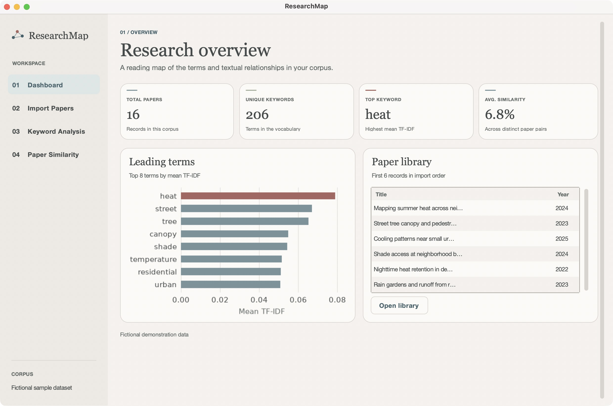
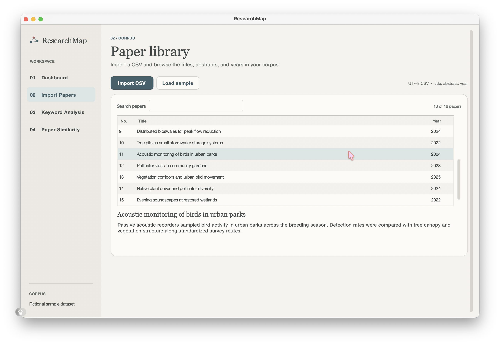
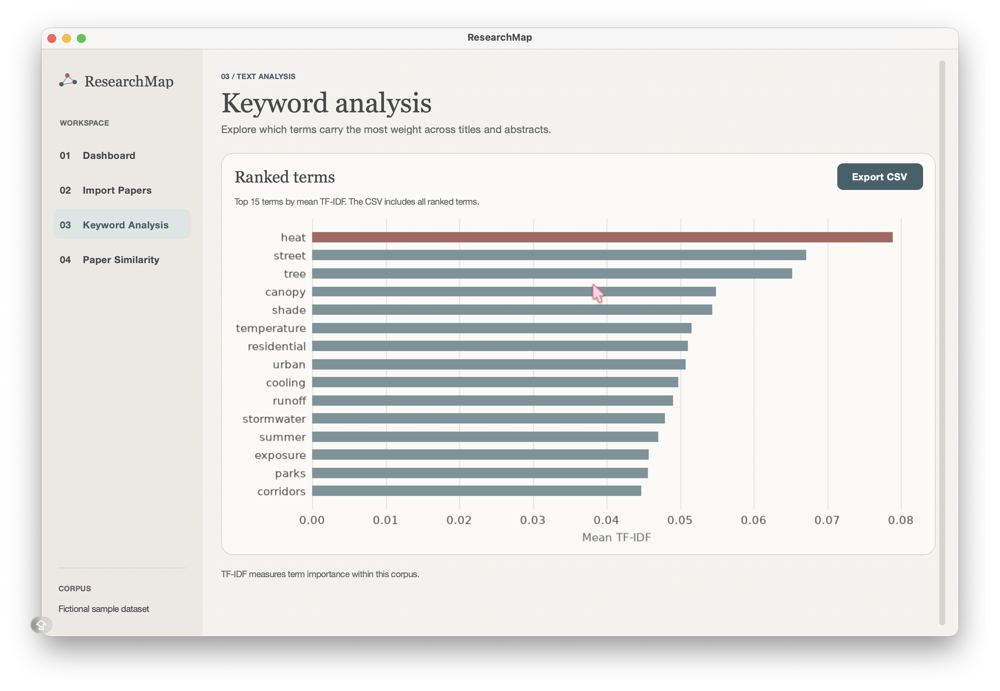
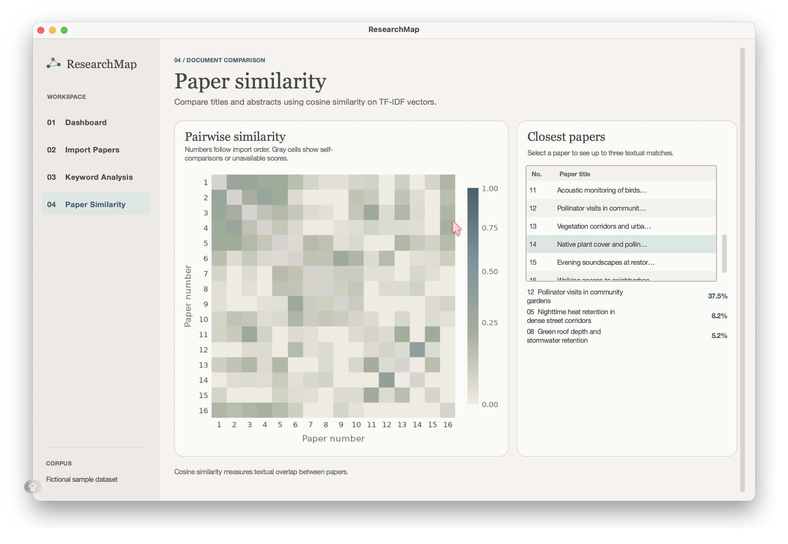

# ResearchMap

ResearchMap is a small Python desktop project for exploring academic paper titles and abstracts. I built it to make it easier to browse a collection of papers, see which words appear most prominently, and compare papers based on their text. The app runs locally and reads data from a CSV file.

## Features

- **Dashboard** shows paper count, vocabulary size, the highest-ranked term, average pairwise similarity, and a preview of the corpus.
- **Paper library** imports CSVs, searches titles, abstracts, and years, and shows the abstract for a selected record.
- **Keyword analysis** ranks terms by mean TF-IDF, charts the top 15, and exports all scores to CSV.
- **Paper similarity** shows a cosine similarity heatmap and up to three closest papers for each selection. The heatmap uses the same paper numbers as the library.

## Run on macOS with VS Code

1. Install [Python 3.13 from python.org](https://www.python.org/downloads/macos/) and the [Python extension for VS Code](https://marketplace.visualstudio.com/items?itemName=ms-python.python). The python.org macOS installer includes Tk.
2. In VS Code, choose **File → Open Folder…** and select the `ResearchMap` folder containing `main.py`.
3. Choose **Terminal → New Terminal** and run these commands from the project folder.

   ```sh
   /Library/Frameworks/Python.framework/Versions/3.13/bin/python3 -m venv .venv
   source .venv/bin/activate
   python -m pip install -r requirements.txt
   python main.py
   ```

4. To use the editor’s run button, open the Command Palette with **⌘⇧P**, choose **Python: Select Interpreter**, and select `.venv/bin/python`. Open `main.py` and choose **Run Python File**.

If you need to check Tk support, run `python -m tkinter` in the activated environment. It should open a small test window.

## CSV format

Save the file as a comma-separated UTF-8 CSV with `title`, `abstract`, and `year` headers. Titles are required. Abstracts and years may be blank. When supplied, a year must contain four digits. Quote fields containing commas or line breaks. The app accepts up to 500 papers per import and ignores extra columns.

```csv
title,abstract,year
"Street trees and summer heat","Sensors recorded temperatures in shaded and exposed street segments.",2024
"Rain gardens and runoff",,2023
```

ResearchMap opens with `data/sample_papers.csv`. All 16 records are **fictional demonstration data** created for this project. Choose **Import Papers → Import CSV** to open your own dataset. A successful import replaces the current corpus for the session.

## Screenshots



### Paper library



### Keyword analysis



### Paper similarity



All screenshots use the included fictional demonstration corpus.

## How the analysis works

The app combines each paper's title and abstract, then uses TF-IDF to represent the text numerically. The keyword view ranks terms by their average TF-IDF score across the collection. The similarity view compares these vectors using cosine similarity: a higher score means the texts share more weighted vocabulary, not necessarily that the papers reach the same conclusions.

## Technologies and project layout

| File | Responsibility |
| --- | --- |
| `main.py` | CustomTkinter navigation, views, and file dialogs |
| `ui_components.py` | Shared styles, Tk tables, and Matplotlib charts |
| `analyzer.py` | Pandas data preparation and scikit-learn TF-IDF and cosine similarity |
| `test_analyzer.py` | Standard-library `unittest` checks for CSV validation and analysis |

Run the tests from the project folder with `python -m unittest -v`.

## Limitations

- TF-IDF measures term importance within the imported corpus. It cannot determine scientific significance. ResearchMap uses individual words and English stop-word filtering, so synonyms, phrases, and multilingual corpora may be poorly represented.
- Cosine similarity measures overlap between weighted text vectors. It does not assess research quality, agreement, or the strength of evidence. A blank abstract leaves only the title available for analysis.
- The dashboard averages scores across distinct comparable paper pairs. Papers with no usable terms are omitted from those comparisons. A corpus with fewer than two comparable papers has no average similarity.
- Analysis uses the supplied titles and abstracts. The app does not retrieve publications or read PDFs. Imports stay in memory for the session.
